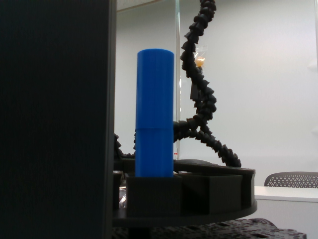
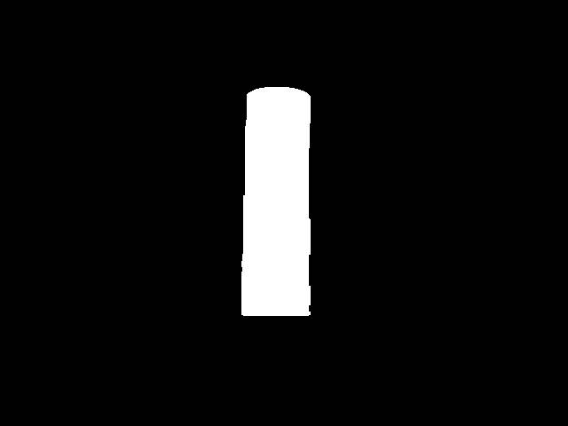
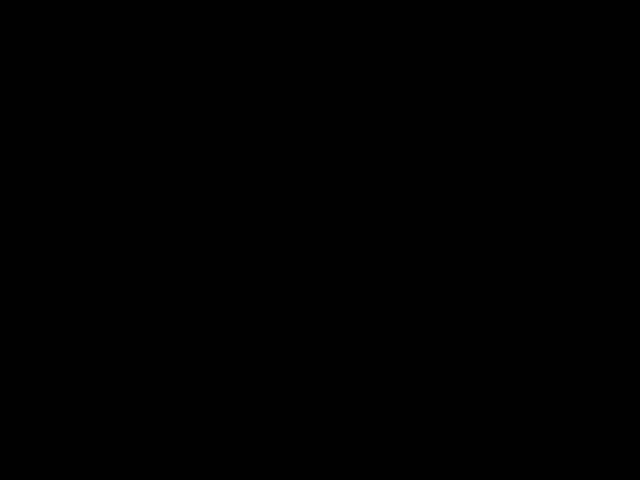

# 모듈 3 — 설정값에 따른 Mask와 검출 결과 변화 분석

[실행 방법, 코드 출처](README.md) ,  [증거 파일 안내](references/evidence-index.md)

## 1 사용한 환경, 입력 사진, 토픽 구성

- **환경:** Ubuntu 24.04, Python 3.12.3, OpenCV 4.6.0, ROS 2 lyrical
- **촬영 조건:** 원통(30 × 30 × 60 mm) 2개를 쌓고 하단 28 mm를 가렸음, 원반에서 회전하며 카메라와의 거리가 달라지는 조건으로 촬영했음
- **비교 입력:** 저장된 `frame-045` 한 장을 모든 A/B 실험에 반복 사용했음, 해상도는 640 × 480, 인코딩은 `bgr8`임, 목표가 보이지 않는 `frame-170`과 일부 가려진 `frame-130`도 A 설정으로 확인함

저장 사진을 ROS 2 토픽으로 다시 입력함, 노드 실행과 증거 수집은 Claude Code, Codex의 보조로 진행함

| 자료 | 토픽 이름 | 메시지 타입 | 발행 노드 | 수신 도구 |
| --- | --- | --- | --- | --- |
| 원본 | `/camera/camera/color/image_raw` | `sensor_msgs/msg/Image` | `/_ros2cli_219736` | RViz, 증거 수신 노드 |
| Mask | `/target/debug/mask/compressed` | `sensor_msgs/msg/CompressedImage` | `/target_detector` | RViz, rqt_image_view, 증거 수신 노드 |
| 검출 표시 | `/target/debug/overlay/compressed` | `sensor_msgs/msg/CompressedImage` | `/target_detector` | RViz, 증거 수신 노드 |
| 검출 수치 | `/target` | `geometry_msgs/msg/PointStamped` | `/target_detector` | 증거 수신 노드 |

발행 노드는 [1-A의 실제 토픽 정보](results/selected-20261014-001/runs/exp1-A/received/topic-info.json)를 기준으로 기록함

## 2 설정값 A/B와 바꾸기 전 예상

실험 1은 색, 밝기 조건에 따라 남는 영역의 변화를, 실험 2는 최소 면적 기준에 따라 후보가 통과하거나 제외되는 차이를 비교함

| 실험 | 변경 변수 | A | B | 사전 예상 |
| --- | --- | --- | --- | --- |
| 1 | V 하한 `hsv_lower[2]` | 40 | 180 | 밝기 조건이 높아져 목표가 Mask에서 사라지고 미검출 |
| 2 | 최소 면적 `min_area_px` | 100 px제곱 | 50,000 px제곱 | Mask는 유지되지만 작은 후보가 제외되어 미검출 |

예상은 실행 전 계획에 기록된 내용임 V의 범위는 0–255

같은 사진에서 변수 하나씩 바꿨음, 기준 HSV는 `[100,120,40]`–`[130,255,255]`이며, 실험 2에서는 이 값으로 복원함, `detect_scale=1`, `morph_kernel=5`, `selection=priority`, `use_depth=false`, `use_object_tracker=false`를 고정하고, 설정마다 노드를 재시작함

## 3 실제 결과와 증거 이미지, 로그

| 실행 | Mask 흰색 픽셀 | `/target` z | 통과 후보 수 | 증거 |
| --- | ---: | ---: | ---: | --- |
| 1-A | 18,979 | 0.06 | 1 | [수신 자료](results/selected-20261014-001/runs/exp1-A/) |
| 1-B | 0 | 0.00 | 0 | [수신 자료](results/selected-20261014-001/runs/exp1-B/) |
| 2-A | 18,979 | 0.06 | 1 | [수신 자료](results/selected-20261014-001/runs/exp2-A/) |
| 2-B | 18,979 | 0.00 | 0 | [수신 자료](results/selected-20261014-001/runs/exp2-B/) |
| 목표가 보이지 않는 사진 (A) | 0 | 0.00 | 0 | [수신 자료](results/selected-20261014-001/runs/absent/) |
| 일부 가려진 사진 (A) | 12,166 | 0.04 | 1 | [수신 자료](results/selected-20261014-001/runs/holdout-occluded/) |

소수는 둘째 자리까지 반올림함, 기준 A의 x=-0.03, y=-0.04임, 흰색 픽셀 수는 수신 Mask에서 밝기 127을 초과한 픽셀 수이며, 윤곽선 면적과는 다름, 후보 수는 검출 로그의 `n_candidates`에서 확인함

| 1-A | 1-B | 2-B |
| --- | --- | --- |
|  |  |  |

1-B에서는 Mask에서 원기둥 영역이 사라짐, 2-B에서는 Mask에 원기둥 영역이 그대로 남아 있었지만 검출되지 않았음

각 수신 자료에는 원본, Mask, 검출 표시 영상, 수신 메시지, 실제 적용값(`runtime.yaml`), 검출 로그와 뷰어 캡처가 있음, 입력 프레임과 수신 시각은 [증거 파일 안내](references/evidence-index.md)에 연결함, 목표가 보이지 않는 사진에서도 입력과 검출 메시지는 계속 수신됐고, 검출값은 0이었음

## 4 왜 그런 결과가 나왔는지 코드 조건으로 설명

원본 수신 → HSV 변환 → 색 범위 필터 → 잡음 제거, 구멍 메우기 → Mask → 면적 필터 → 검출 결과 발행

- **1-B:** `cv2.inRange`의 밝기 하한 180 조건을 통과하지 못해 원기둥 영역이 Mask에서 사라짐
- **2-B:** Mask에는 남았지만 윤곽선 면적이 **약 18,600 px제곱**으로 최소 면적 50,000 px제곱보다 작았음, `if area < min_area_px` 조건에 따라 후보에서 제외됐음, 이 조건은 Mask 자체를 지우지 않음

`/target`의 x, y는 영상 중심 기준 위치 비율이며 오른쪽, 아래쪽이 양수임, z는 윤곽선 면적을 전체 영상 면적으로 나눈 비율임, 모두 단위가 없고, 미검출이면 x=y=z=0을 발행함, [코드 조건과 출처](references/code-evidence.md)

## 5 최종 선택값과 이유

원래는 원기둥이 회전하면서 거리가 달라져도 계속 검출되는지 보고 싶었음, 설정값에 따른 차이를 확인할 수 있었고 원기둥을 검출했음

이번 저장 사진에서는 **A(V 하한 40, 최소 면적 100 px제곱)**를 기준값으로 선택함, A에서는 원기둥이 검출됐고, 1-B와 2-B에서는 검출되지 않았기 때문임
